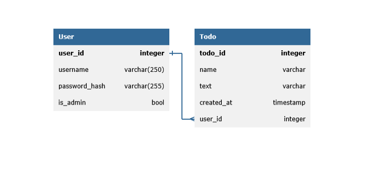

# Todo-List
## ER диаграмма

## Архитектура
- Domain. Кладем сущности и интерфейсы для репозиториев.
- Application. лежат сервисы, реализующую бизнес логику
- Infrastructure. реализация интерфейсов репозитория, код, зависиящий от источника данных
- Web. веб версия
- Desktop. WPF версия

## План обучения
1. Вспомнить SQL
2. Вспомнить .NET
3. Подробнее ознакомится с чистой архитектурой
4. Почитать про WPF
5. Почитать про авторизацию по токенам
6. Изучить httplistener 
7. Поделать ендпоинты
8. Скачать и изучить Postman
9. Поделать middleware

## Стори
1. Нарисовать ER-диаграмму и создать БД
2. Заполнить тестовыми данными
3. Реализовать Domain слой (сущности и интерфейсы репозиториев)
4. Реализовать Application слой (сервисы для юзеров и задач)
5. Реализовать Infrastructure слой (работа с БД)

### Desktop (WPF)
1. Сделать экран логина/регистрации
2. Сделать главный экран со списком тудушек 
3. Прикрутить CRUD (добавление, галочка выполнения, удаление)

### Web (HttpListener)
1. Сделать сервер на HttpListener
2. Сделать CRUD, парсинг JSON
3. Прикрутить авторизацию (самописный middleware)
4. Сделать эндпоинты для регистрации и логина
5. Потестировать через Postman